<picture>
  <source media="(prefers-color-scheme: dark)" srcset="website/public/readme/hero.en.dark.svg">
  
</picture>

<p align="center">
  <a href="https://lendevs.github.io/LenBot/"><b>Documentation (zh)</b></a> ·
  <a href="https://lendevs.github.io/LenBot/start/quick-start">Quick start (zh)</a> ·
  <a href="https://lendevs.github.io/LenBot/develop/personas">Personas (zh)</a> ·
  <a href="developer/plugins-v1.en.md">Plugin interface</a> ·
  <a href="README.md">中文</a>
</p>

<p align="center">
  <a href="https://github.com/lendevs/LenBot/releases/latest"></a>
  
  
  
</p>

**LenBot is a group chat agent that decides for itself.** When to speak, whom to answer, what to look up first and when to follow up are decided by a ReAct loop, where the model alternates between reasoning and calling tools. It connects to QQ (OneBot v11) and needs a chat model and its API key.

<picture>
  <source media="(prefers-color-scheme: dark)" srcset="website/public/readme/turn.en.dark.svg">
  
</picture>

## Capabilities

<p align="center">
  <a href="https://lendevs.github.io/LenBot/use/chatting"><picture><source media="(prefers-color-scheme: dark)" srcset="website/public/readme/listen.en.dark.svg"></picture></a>
  <a href="https://lendevs.github.io/LenBot/connect/web"><picture><source media="(prefers-color-scheme: dark)" srcset="website/public/readme/lookup.en.dark.svg"></picture></a>
  <a href="https://lendevs.github.io/LenBot/use/tasks"><picture><source media="(prefers-color-scheme: dark)" srcset="website/public/readme/follow.en.dark.svg"></picture></a>
  <a href="https://lendevs.github.io/LenBot/use/memory"><picture><source media="(prefers-color-scheme: dark)" srcset="website/public/readme/memory.en.dark.svg"></picture></a>
  <a href="https://lendevs.github.io/LenBot/use/personas"><picture><source media="(prefers-color-scheme: dark)" srcset="website/public/readme/persona.en.dark.svg"></picture></a>
  <a href="https://lendevs.github.io/LenBot/use/plugins"><picture><source media="(prefers-color-scheme: dark)" srcset="website/public/readme/plugin.en.dark.svg"></picture></a>
</p>

- **One decision loop.** Once woken, the same chat model decides, looks things up and replies within one tool loop. Staying silent and continuing to listen is the model's choice too.
- **Checks before answering.** Searches the web, reads pages, queries chat history and long-term memory, retrieves persona and group reference files, inspects images, opens forwarded threads and calls MCP (Model Context Protocol) servers on demand.
- **Follow-ups.** The model can set reminders for group members, register topics to keep an eye on, or hand long-running work to background tasks in isolated containers.
- **Memory and learning.** Memory is stored locally as Markdown files per group. While the group is idle, the chat model continues the same session prefix to curate memory and learn group phrasing, slang and how replies were received.
- **Persona packages.** A name and a profile make a persona; voice notes, rotating styles, examples, reference files and stickers are optional. Each group binds its own persona and switches without a restart.
- **Plugins.** Python plugins add commands, scheduled broadcasts, model tools or long-term memory backends, enabled per group and run inline or in a separate process.

## Playground

<picture>
  <source media="(prefers-color-scheme: dark)" srcset="website/public/readme/playground.en.dark.svg">
  
</picture>

The panel's playground simulates a group in an isolated instance: add members, pick who speaks, and copy the group's recent messages as the starting context. Turns run the same way as in a real group; replies stay in the panel. [Playground (zh) →](https://lendevs.github.io/LenBot/start/playground)

## Quick start

<picture>
  <source media="(prefers-color-scheme: dark)" srcset="website/public/readme/setup.en.dark.svg">
  
</picture>

Prepare a OneBot v11 implementation logged in to QQ (for example [SnowLuma](https://github.com/SnowLuma/SnowLuma), recommended) and an API key for a chat model service, then pick a deployment:

| Deployment | Requirements | Guide |
|---|---|---|
| Docker | Docker Engine or Docker Desktop, Compose v2 | [Docker (zh)](https://lendevs.github.io/LenBot/start/docker) |
| Package | Linux, macOS or Windows with [uv](https://docs.astral.sh/uv/) | [Packages (zh)](https://lendevs.github.io/LenBot/start/package) |
| Source | uv and Node.js 22, follows `master` | [From source (zh)](https://lendevs.github.io/LenBot/start/source) |

<details>
<summary><b>Docker</b></summary>

```sh
mkdir lenbot && cd lenbot
docker run --rm --entrypoint python \
  -v "$PWD:/deployment" -v /var/run/docker.sock:/var/run/docker.sock \
  ghcr.io/lendevs/lenbot-updater:0.2.0 /opt/lenbot-updater/init.py --version 0.2.0
docker compose -p lenbot -f host.compose.yaml -f host.version.compose.yaml \
  -f host.updater.compose.yaml up -d
docker compose -p lenbot -f host.compose.yaml -f host.version.compose.yaml \
  -f host.updater.compose.yaml logs lenbot
```

</details>

<details>
<summary><b>Package</b></summary>

Download the package for your platform from [Releases](https://github.com/lendevs/LenBot/releases/latest), extract it and run in the package directory:

```sh
./install.sh install "$HOME/lenbot"
"$HOME/lenbot/run"
```

```powershell
powershell -NoProfile -ExecutionPolicy Bypass -File .\install.ps1 install "$env:USERPROFILE\lenbot"
& "$env:USERPROFILE\lenbot\run.cmd"
```

</details>

<details>
<summary><b>Source</b></summary>

```sh
git clone https://github.com/lendevs/LenBot.git
cd LenBot
./scripts/install.sh
uv run --no-sync len-bot
```

</details>

On first start the terminal or container log prints a one-time setup link. Open it and follow the five-step wizard to set up the panel account, connect QQ, fill in the owner account, and choose a chat model and persona. Try a few turns in the playground, then switch delivery to QQ on the overview page.


## Documentation

The documentation site is in Chinese. The web panel is available in Chinese and English.

| Topic | Entry |
|---|---|
| Deployment, connections and daily use | [Documentation site (zh)](https://lendevs.github.io/LenBot/) |
| Writing persona packages | [Authoring personas (zh)](https://lendevs.github.io/LenBot/develop/personas), [example persona](examples/personas/companion/) |
| Writing plugins | [Authoring plugins (zh)](https://lendevs.github.io/LenBot/develop/plugins), [Plugin interface v1](developer/plugins-v1.en.md), [plugin template](https://github.com/lendevs/lenbot-plugin-template) |
| Deployment bundles, containers and host operations | [Deployment guide](deploy/README.en.md) |
| Core architecture and module notes | [Developer docs (zh)](developer/README.md) |
| Contributing to core | [CONTRIBUTING](CONTRIBUTING.en.md) |

Built-in prompts are in Chinese.

## License

Original code is licensed under [AGPL-3.0-only](LICENSE); see [NOTICE](NOTICE). Third-party dependencies and separate services keep their own licenses; see [THIRD_PARTY_NOTICES](THIRD_PARTY_NOTICES.md).
