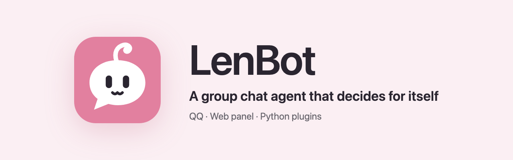
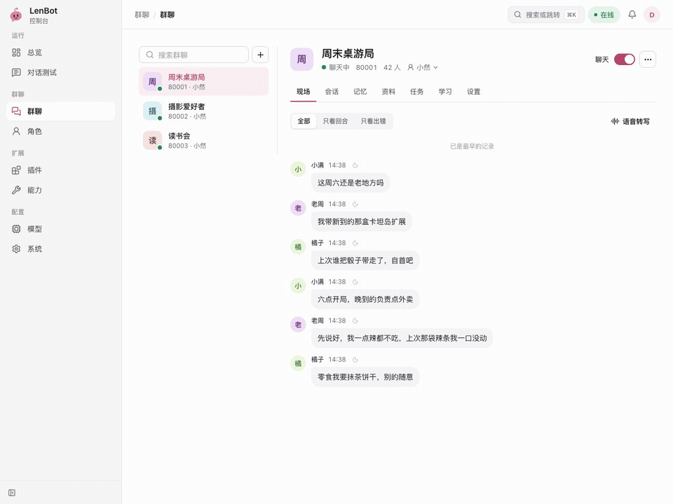

<p align="center"></p>

<p align="center">
  <a href="README.md">中文</a> ·
  <a href="https://lendevs.github.io/LenBot/">Documentation (zh)</a> ·
  <a href="https://lendevs.github.io/LenBot/guide/quick-start">Quick start (zh)</a> ·
  <a href="developer/plugins-v1.en.md">Plugin interface</a>
</p>

<p align="center">
  
  
  
</p>

**LenBot is a group chat agent that decides for itself.** When to speak, whom to answer, what to look up first and when to follow up are decided by the model in a multi-step tool loop. It runs on QQ (OneBot v11) and needs only one chat model and its API key.



<sub>The live view in the panel shows every turn as it happens: which chat history was searched, what the model thought at each step and what it sent. The recording comes from a demo instance.</sub>

## Highlights

- **One decision loop.** Once woken, the same chat model decides, looks things up and replies within one tool loop. Staying silent is a decision too.
- **Checks before answering.** Web search, page reading, chat history, memory, images, forwarded messages and MCP servers. Search and page reading can use free options or paid APIs.
- **Schedules its own follow-ups.** The model can set reminders for group members or for itself, and hand long work to background tasks.
- **Memory and learning.** Memory is stored locally as Markdown files, one directory per group. While the group is idle, the chat model continues the same session to update memory and learn the group's phrases, slang and how its replies landed, reusing the provider's prompt cache.
- **Personas.** A persona needs only a name and a short profile. Each group can use a different persona, switched without a restart.
- **Plugins.** Python plugins add commands, scheduled posts and model tools, enabled per group, with settings applied without a restart.
- **Web panel.** First-time setup, settings, test chats and logs all live in the panel, and every turn can be inspected step by step.

## Quick start

You need [uv](https://docs.astral.sh/uv/), Node.js 22, a OneBot implementation logged in to QQ (for example [NapCat](https://github.com/NapNeko/NapCatQQ)) and an API key for a model service.

```sh
git clone https://github.com/lendevs/LenBot.git
cd LenBot
./scripts/install.sh
uv run --no-sync len-bot
```

On first start the terminal prints a setup link. Open it in a browser and follow the five-step wizard to connect QQ and choose a model and persona. Pick simulated delivery first, try a few rounds in the panel's test chat, then switch to sending to QQ on the overview.


## Documentation

The documentation site is in Chinese. The panel is available in Chinese and English.

| Topic | Where |
|---|---|
| Setup and daily use | [Documentation site](https://lendevs.github.io/LenBot/) |
| Writing plugins | [Plugin interface v1](developer/plugins-v1.en.md), [plugin template](https://github.com/lendevs/lenbot-plugin-template) |
| Writing personas | [Persona packages](developer/personas.md), [example persona](examples/personas/companion/) |
| Local companion services | [Deployment notes](deploy/README.en.md) |
| Contributing | [CONTRIBUTING](CONTRIBUTING.en.md) |

## Status

LenBot is under development and has no release yet; run it from source. Prompts are Chinese only.

## License

Original code is licensed under [AGPL-3.0-only](LICENSE); see [NOTICE](NOTICE). Third-party dependencies and separate services keep their own licenses; see [THIRD_PARTY_NOTICES](THIRD_PARTY_NOTICES.md).
