<picture>
  <source media="(prefers-color-scheme: dark)" srcset="website/public/readme/hero.dark.svg">
  
</picture>

<p align="center">
  <a href="https://lendevs.github.io/LenBot/"><b>文档</b></a> ·
  <a href="https://lendevs.github.io/LenBot/start/quick-start">快速开始</a> ·
  <a href="https://lendevs.github.io/LenBot/develop/personas">写角色包</a> ·
  <a href="https://lendevs.github.io/LenBot/develop/plugins">写插件</a> ·
  <a href="README.en.md">English</a>
</p>

<p align="center">
  <a href="https://github.com/lendevs/LenBot/releases/latest"></a>
  
  
  
</p>

**LenBot 是自主决策的群聊 Agent。** 何时开口、回复谁、先查什么、何时跟进，由 ReAct Loop（模型交替思考与调用工具的循环）决定。接入 QQ（OneBot v11），需要一个聊天模型和它的 API Key。

<picture>
  <source media="(prefers-color-scheme: dark)" srcset="website/public/readme/turn.dark.svg">
  
</picture>

## 能力

<p align="center">
  <a href="https://lendevs.github.io/LenBot/use/chatting"><picture><source media="(prefers-color-scheme: dark)" srcset="website/public/readme/listen.dark.svg"></picture></a>
  <a href="https://lendevs.github.io/LenBot/connect/web"><picture><source media="(prefers-color-scheme: dark)" srcset="website/public/readme/lookup.dark.svg"></picture></a>
  <a href="https://lendevs.github.io/LenBot/use/tasks"><picture><source media="(prefers-color-scheme: dark)" srcset="website/public/readme/follow.dark.svg"></picture></a>
  <a href="https://lendevs.github.io/LenBot/use/memory"><picture><source media="(prefers-color-scheme: dark)" srcset="website/public/readme/memory.dark.svg"></picture></a>
  <a href="https://lendevs.github.io/LenBot/use/personas"><picture><source media="(prefers-color-scheme: dark)" srcset="website/public/readme/persona.dark.svg"></picture></a>
  <a href="https://lendevs.github.io/LenBot/use/plugins"><picture><source media="(prefers-color-scheme: dark)" srcset="website/public/readme/plugin.dark.svg"></picture></a>
</p>

- **决策回合**：唤醒后，判断、查询和回复在同一个Agent循环中完成。
- **查证回答**：按需搜索网页、读取正文、查询聊天记录与长期记忆、检索角色和本群资料、识别图片、读取合并转发。
- **主动跟进**：模型可以为群友创建提醒、登记持续关注的事项，或把耗时工作交给隔离容器中的后台任务。
- **记忆学习**：记忆以 Markdown 文件按群保存在本地。学习群内的说法、黑话和回复效果。
- **角色包**：名字和人物设定即可组成一个角色，附带说话方式、轮换风格、样例、资料与表情库。
- **插件**：用 Python 添加命令、定时播报、模型工具或长期记忆实现，按群启用。

## 对话测试

<picture>
  <source media="(prefers-color-scheme: dark)" srcset="website/public/readme/playground.dark.svg">
  
</picture>

来使用面板的对话测试模拟群聊吧：添加群友、选择发言身份、复制群内最近的消息作为初始上下文。[对话测试 →](https://lendevs.github.io/LenBot/start/playground)

## 快速开始

<picture>
  <source media="(prefers-color-scheme: dark)" srcset="website/public/readme/setup.dark.svg">
  
</picture>

准备一个已登录 QQ 的 OneBot v11 实现（例如 [SnowLuma](https://github.com/SnowLuma/SnowLuma)，推荐使用）和聊天模型服务的 API Key，再选一种部署方式：

| 部署方式 | 运行环境 | 文档 |
|---|---|---|
| Docker | Docker Engine 或 Docker Desktop，Compose v2 | [Docker 部署](https://lendevs.github.io/LenBot/start/docker) |
| 部署包 | Linux、macOS、Windows，需要 [uv](https://docs.astral.sh/uv/) | [部署包](https://lendevs.github.io/LenBot/start/package) |
| 源码 | uv 与 Node.js 22，跟随 `master` 开发 | [源码运行](https://lendevs.github.io/LenBot/start/source) |

<details>
<summary><b>Docker</b></summary>

```sh
mkdir lenbot && cd lenbot
docker run --rm --entrypoint python \
  -v "$PWD:/deployment" -v /var/run/docker.sock:/var/run/docker.sock \
  ghcr.io/lendevs/lenbot-updater:0.2.0 /opt/lenbot-updater/init.py --version 0.2.0
docker compose -p lenbot -f host.compose.yaml -f host.version.compose.yaml \
  -f host.updater.compose.yaml up -d
docker compose -p lenbot -f host.compose.yaml -f host.version.compose.yaml \
  -f host.updater.compose.yaml logs lenbot
```

</details>

<details>
<summary><b>部署包</b></summary>

从 [Releases](https://github.com/lendevs/LenBot/releases/latest) 下载对应平台的部署包，解压后在包目录中执行：

```sh
./install.sh install "$HOME/lenbot"
"$HOME/lenbot/run"
```

```powershell
powershell -NoProfile -ExecutionPolicy Bypass -File .\install.ps1 install "$env:USERPROFILE\lenbot"
& "$env:USERPROFILE\lenbot\run.cmd"
```

</details>

<details>
<summary><b>源码</b></summary>

```sh
git clone https://github.com/lendevs/LenBot.git
cd LenBot
./scripts/install.sh
uv run --no-sync len-bot
```

</details>

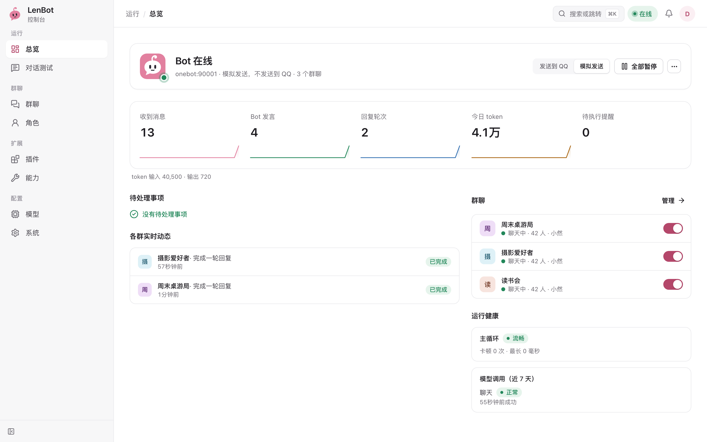

## 文档

| 用途 | 入口 |
|---|---|
| 部署、接入与日常使用 | [文档站](https://lendevs.github.io/LenBot/) |
| 编写角色包 | [写角色包](https://lendevs.github.io/LenBot/develop/personas)、[示例角色小然](examples/personas/companion/) |
| 编写插件 | [写插件](https://lendevs.github.io/LenBot/develop/plugins)、[插件接口 v1](developer/plugins-v1.md)、[插件模板](https://github.com/lendevs/lenbot-plugin-template) |
| 部署包、容器配方与本机运维 | [部署资料](deploy/README.md) |
| 核心架构与模块说明 | [开发者文档](developer/README.md) |
| 参与核心开发 | [CONTRIBUTING](CONTRIBUTING.md) |

内置提示词为中文，网页面板支持中文和英文。

## 许可证

原创代码采用 [AGPL-3.0-only](LICENSE) 许可，详见 [NOTICE](NOTICE)。第三方依赖和独立服务沿用各自的许可，见 [THIRD_PARTY_NOTICES](THIRD_PARTY_NOTICES.md)。
